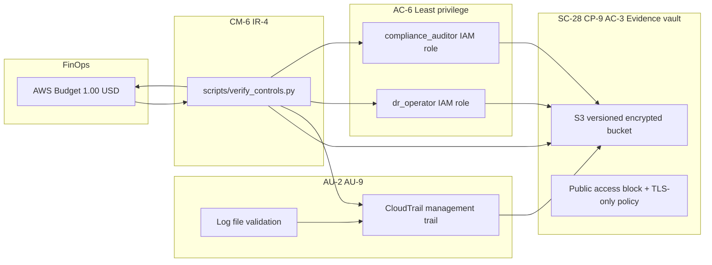

# earthling-cloud-dr-lab

Turn enterprise DR and IR bridge discipline into **auditable, Governance-as-Code cloud controls**. This repository deploys a **$0-safe AWS lab** (live demo) and ships an **Azure Terraform mirror** for the same NIST 800-53 Rev 5 control story.

Built for technical interviews with security engineering leaders who care about continuous monitoring evidence, not slide decks.

## Problem

Traditional DR bridges rely on people, spreadsheets, and screenshots. Assessors and MSSPs need **machine-verifiable** proof that access, encryption, versioning, audit logging, and spend guardrails stay in place between assessments. This lab wires those controls to Terraform and a single verification script you can run before, during, and after an incident drill.

## Architecture



## NIST 800-53 Rev 5 mapping

| Control | Requirement (short) | AWS implementation |
|---------|---------------------|-------------------|
| **AC-3** | Access enforcement | S3 Block Public Access (all 4), deny non-TLS bucket policy |
| **AC-6** | Least privilege | `dr_operator` and `compliance_auditor` roles, no `AdministratorAccess` |
| **AU-2** | Auditable events | CloudTrail management event logging |
| **AU-9** | Protection of audit info | CloudTrail log file validation; logs in private versioned bucket |
| **CM-6** | Configuration settings | Terraform as source of truth; plan/apply for drift |
| **CP-9** | System backup | S3 versioning on evidence vault |
| **IR-4** | Incident handling | Break-and-fix drill in [runbook](docs/INCIDENT_RUNBOOK_AND_RCA.md) |
| **SC-28** | Protection at rest | S3 default encryption AES256 |

Tags on every resource: `NIST_Control`, `Project = earthling-cloud-dr-lab`, `Owner = Sky Coleman`, `ManagedBy = Terraform`, `Environment = lab`.

## Quickstart (AWS)

```bash
cd terraform/aws
terraform init
terraform plan
terraform apply
```

Capture outputs, then verify:

```bash
python scripts/verify_controls.py \
  --bucket "<evidence_vault_bucket_name>" \
  --trail "earthling-dr-management-audit" \
  --budget "earthling-dr-zero-spend-guardrail" \
  --out evidence/control_verification.json
```

**Break-and-fix drill:** follow [docs/INCIDENT_RUNBOOK_AND_RCA.md](docs/INCIDENT_RUNBOOK_AND_RCA.md) (console drift on public access block, then `terraform apply`).

**Teardown:**

```bash
cd terraform/aws
terraform destroy
```

Record outputs in [evidence/TEARDOWN_PROOF.md](evidence/TEARDOWN_PROOF.md).

## Azure mirror

```bash
cd terraform/azure
terraform init
terraform plan
# apply when a subscription is available for demo
```

See [docs/AWS_TO_AZURE_MAPPING.md](docs/AWS_TO_AZURE_MAPPING.md) for service parity.

## Documentation

| Document | Purpose |
|----------|---------|
| [docs/AWS_TO_AZURE_MAPPING.md](docs/AWS_TO_AZURE_MAPPING.md) | Cross-cloud control translation |
| [docs/INCIDENT_RUNBOOK_AND_RCA.md](docs/INCIDENT_RUNBOOK_AND_RCA.md) | Deliberate drift drill and RCA |
| [docs/DECISION_LOG.md](docs/DECISION_LOG.md) | Why Terraform, $0 scope, and production next steps |
| [evidence/TEARDOWN_PROOF.md](evidence/TEARDOWN_PROOF.md) | Live session evidence template |

## Cost guardrails

No NAT Gateways, EC2, RDS, EKS, AWS Config recorder, or unattached Elastic IPs. First CloudTrail management trail in a region and this S3 footprint target **$0** on a clean account. A **$1.00** AWS Budget fires at 50% actual and 100% forecast spend.

## License

MIT (add `LICENSE` if publishing to GitHub).