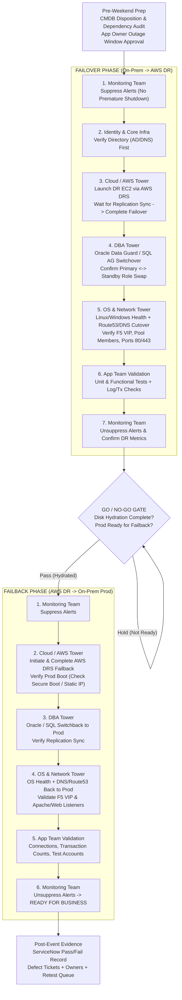

# Enterprise Application DR Runbook (Reference Pattern)

**Scope:** Generic Tier-1 Enterprise Application (On-Premises Primary <-> AWS DR Region)  
**Stack Pattern:** AWS Elastic Disaster Recovery (AWS DRS) + Oracle Data Guard / SQL Server AG + F5 Load Balancer + DNS/Route53 + ServiceNow Change & Evidence Tracking  
**NIST 800-53 Alignment:** `CP-2` (Contingency Plan), `CP-4` (Contingency Plan Testing), `CP-9` (System Backup), `CM-8` (System Component Inventory), `IA-2` (Identity First), `SC-7` (Boundary / VIP Validation)

> *Note: This is a generic reference runbook template reflecting enterprise failover/failback sequencing and gate discipline.*

---

## 1. End-to-End Failover & Failback Tower Flow

---

## 2. Nine-Phase Application Runbook Table

| Phase | Tower / Owner | Key Actions | Exit Gate / Audit Evidence | NIST 800-53 |
| :--- | :--- | :--- | :--- | :--- |
| **0. Pre-Weekend Prep** | DR Lead + App Owners | Pull weekly app scope; verify CMDB dispositions (DRS / Backup / Oracle / SQL / Colo exclusions); reconcile stale runbooks vs CMDB; confirm approved outage window | Signed-off per-app plan; dependency order locked | `CM-8`, `CP-2` |
| **1. Pre-Failover** | Monitoring Team | Suppress monitoring alerts for scoped hosts; enforce explicit rule: **do not shut down servers** prior to planned DRS cutover | Alert suppression ticket & timestamp | `SI-4`, `CP-4` |
| **2. Identity & Core** | Directory / Infra | Confirm directory services (AD/DNS) and core network reachability in recovery zone before app tiers start | Directory sync & DNS resolution verified | `IA-2`, `SC-7` |
| **3. Cloud Failover** | Cloud / AWS Tower | Launch recovery EC2 instances in DR region via AWS DRS (or restore/mount volumes via AWS Backup); wait for sync; complete failover | Instance status checks `2/2 passed`; start/end timestamps logged | `CP-9`, `CP-4` |
| **4. Database Switchover** | DBA Tower | Execute Oracle Data Guard switchover or SQL Server AG failover; confirm new primary role and replication state | DBA sign-off on role swap & read/write test | `CP-9`, `CP-4` |
| **5. OS & Network Cutover** | OS + Network / F5 | Run Linux/Windows health checks; cut over DNS/Route53; validate F5 Virtual Server (VIP), pool member status, and Apache/web listeners (`80`/`443`) | `nslookup`, `netstat`/`ss`, `curl -I` through VIP verified | `SC-7`, `CM-6` |
| **6. Failover Validation** | App Team + DR Lead | Execute unit & functional smoke tests; verify batch/interface connectivity; unsuppress monitoring on DR endpoints | Recorded **PASS** or **FAIL** in live tracker; defects ticketed with owner | `CP-4`, `IR-4` |
| **7. Failback Gate (Hydration)** | DR Lead + Cloud Tower | Confirm production site readiness and **wait for EBS/disk hydration to complete** before starting failback | Hydration completion confirmed before failback start | `CP-4`, `CP-9` |
| **8. Failback & Ready for Business** | All Towers (Mirror) | Suppress alerts -> AWS DRS failback (verify Secure Boot & static IP on boot) -> DBA switchback -> OS/DNS/F5 restore -> App validation (connections, log/transaction counts, test accounts) -> Unsuppress alerts | Status flipped to **Ready for Business**; ServiceNow change closed with evidence | `CP-4`, `AU-6` |

---

## 3. Common Real-World Bridge Snags & Controls

| Failure Mode Observed | Immediate Bridge Action | Process / Control Fix |
| :--- | :--- | :--- |
| **Stale CMDB / hidden shared database** | Pause template copy; meet directly with app team to map real SQL/server dependencies; group shared infrastructure into one test window | Reconcile CMDB source record before next DR setup (`CM-8`) |
| **Slow disk hydration on failback** | Hold the failback gate and monitor hydration completion before resuming production cutover | Track hydration as an explicit mandatory gate in the weekend timeline (`CP-4`) |
| **F5 VIP / Apache / DNS mismatch** | Run ordered checks (`nslookup` -> routing -> listening ports `80`/`443` -> `curl -I` through VIP) and escalate to Network/Web tower | Open defect ticket with named owner and retest in next window (`SC-7`) |
| **Secure Boot / static IP issue on failback** | Escalate to OS/Cloud tower to remediate boot/network config before app validation | Add pre-failback verification step to runbook template (`CM-6`) |
